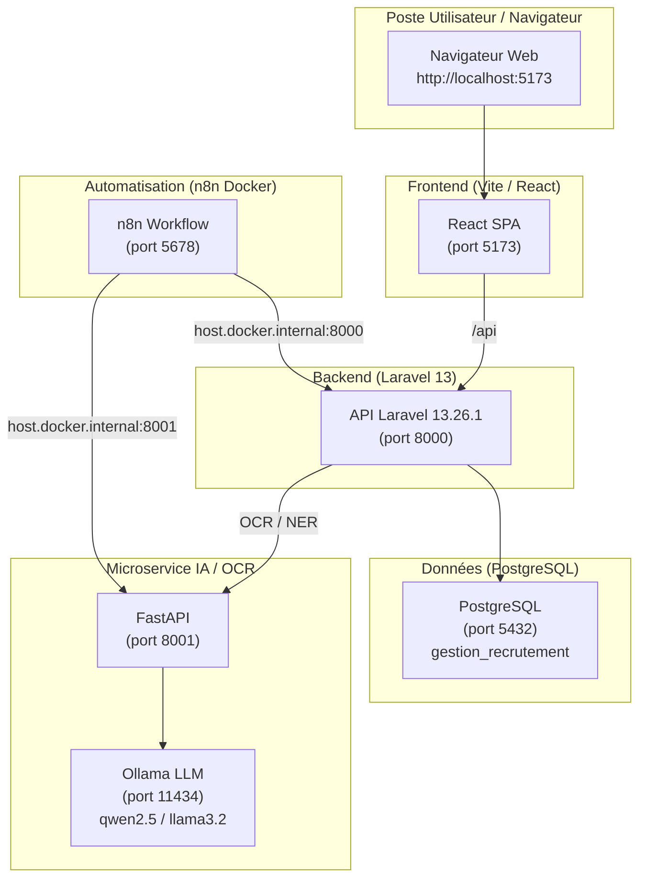

# 🚀 Guide Complet de Déploiement & Migration sur une Nouvelle Machine
## Projet : Plateforme de Recrutement Alpha Ciment

Ce guide permet d'installer et d'exécuter l'intégralité du projet sur **n'importe quel autre ordinateur** (Windows, Linux, macOS) et dans **n'importe quel répertoire/chemin d'accès**.

---

## 🏗️ Architecture Globale du Projet

Le projet est composé de 4 briques interconnectées :
1. **Base de données relationnelle** : PostgreSQL (port 5432)
2. **Backend API & Logique Métier** : Laravel 13 (v13.26.1) / PHP 8.3+ (port 8000)
3. **Frontend Application Web** : React + Vite + Tailwind/Custom CSS (port 5173)
4. **Microservice IA / OCR / NLP** : FastAPI + Python + Ollama LLM (port 8001)
5. **Orchestration & Automatisation** : n8n sous Docker (port 5678)



---

## 📋 1. Logiciels Requis sur la Nouvelle Machine

Installez les outils suivants si ce n'est pas déjà fait :
- **Git** : pour cloner le projet (`git --version`)
- **PHP >= 8.3 (STRICT)** avec Composer :
  - *Note importante* : Le projet tourne sous **Laravel 13.26.1** qui exige **PHP 8.3+** (`"php": "^8.3"` dans `composer.json`). Si la nouvelle machine a PHP 8.2 ou inférieur, `composer install` échouera.
  - *Extensions PHP actives obligatoires dans `php.ini`* : `pdo_pgsql`, `pgsql`, `mbstring`, `openssl`, `curl`, `fileinfo`, `gd`, `zip`, `xml`.
- **Node.js >= 18 ou 20** avec `npm` (`node -v` et `npm -v`)
- **PostgreSQL (15 ou 16)** : avec le client `psql` accessible en ligne de commande.
- **Python (3.10 ou 3.11)** : avec `pip` et `venv` (`python --version`).
- **Ollama** : pour exécuter le LLM local (téléchargeable sur [https://ollama.ai](https://ollama.ai)).
- **Docker Desktop** : pour exécuter l'instance n8n (optionnel si n8n n'est pas utilisé immédiatement).

---

## 🗄️ 2. Configuration de la Base de Données (PostgreSQL)

### A. Démarrer PostgreSQL
Vérifiez que le service PostgreSQL est bien démarré sur le port `5432`.

### B. Importer le schéma et les données initiales
Ouvrez un terminal dans la racine du projet où se trouve le dossier `sql/` :

```bash
# Se connecter avec l'utilisateur postgres et exécuter le script maître :
psql -U postgres -f sql/gestion_recrutement.sql
```
*(Entrez le mot de passe de votre utilisateur postgres local si demandé).*

Ce script SQL unique :
- Crée la base de données `gestion_recrutement`.
- Crée toutes les tables, séquences, contraintes, index et triggers métier.
- Insère automatiquement le jeu de données initial (directions, domaines, statuts, types de contrat, lieux, modèles d'emails, utilisateurs et premières offres).

---

## 🐘 3. Configuration du Backend Laravel 13 (v13.26.1)

Placez-vous dans le dossier du backend :
```bash
cd code_source/recrutement
```

### A. Installer les dépendances PHP
```bash
composer install
```

### B. Configurer le fichier d'environnement `.env`
Si le fichier `.env` n'existe pas, copiez le template :
```bash
# Windows PowerShell :
Copy-Item .env.example .env
# Linux / macOS :
cp .env.example .env
```

Ouvrez `.env` et ajustez les paramètres de base de données selon votre configuration locale :
```ini
APP_NAME="Recrutement Alpha Ciment"
APP_ENV=local
APP_KEY=
APP_DEBUG=true
APP_URL=http://127.0.0.1:8000
FRONTEND_URL=http://127.0.0.1:5173

DB_CONNECTION=pgsql
DB_HOST=127.0.0.1
DB_PORT=5432
DB_DATABASE=gestion_recrutement
DB_USERNAME=postgres
DB_PASSWORD=root   # <-- Mettez votre mot de passe PostgreSQL local ici !

SESSION_DRIVER=database
QUEUE_CONNECTION=database
FILESYSTEM_DISK=local
```

### C. Générer la clé d'application & Créer le lien symbolique de stockage
```bash
# Générer la clé d'application si elle est vide
php artisan key:generate

# TRÈS IMPORTANT : Créer le lien symbolique pour les CVs et documents uploadés
php artisan storage:link

# Optimisation / purge des caches éventuels
php artisan config:clear
php artisan cache:clear
```

### D. (Optionnel) Exécuter les migrations complémentaires
Si vous souhaitez vous assurer que toutes les migrations sont à jour :
```bash
php artisan migrate
```

### E. Lancer le serveur Laravel
```bash
php artisan serve --port=8000
```
L'API est maintenant disponible sur `http://127.0.0.1:8000`.

---

## ⚛️ 4. Configuration du Frontend React

Ouvrez un **deuxième terminal** et placez-vous dans :
```bash
cd code_source/recrutement-react
```

### A. Installer les paquets npm
```bash
npm install
```

### B. Vérifier le fichier `.env`
Vérifiez que le fichier `.env` contient bien :
```ini
VITE_BACKEND_URL=http://127.0.0.1:8000
```

### C. Lancer le serveur de développement Vite
```bash
npm run dev
```
L'application est disponible sur : 👉 **`http://localhost:5173`** !

---

## 🐍 5. Configuration du Microservice IA & OCR (FastAPI + LLM)

Ouvrez un **troisième terminal** et placez-vous dans :
```bash
cd code_source/ocr
```

### A. Créer un environnement virtuel Python propre à la nouvelle machine
```bash
# Créer le venv
python -m venv venv

# Activer le venv :
# Sous Windows PowerShell :
.\venv\Scripts\activate
# Sous Linux / macOS :
source venv/bin/activate
```

### B. Installer les dépendances Python
```bash
pip install -r requirements.txt
```

### C. Démarrer Ollama avec le modèle local
1. Assurez-vous qu'Ollama est lancé sur votre machine.
2. Dans un terminal, téléchargez et préparez le modèle :
```bash
ollama run qwen2.5:7b
# ou si vous préférez Llama :
# ollama run llama3.2
```

### D. Lancer le microservice FastAPI
*(Toujours avec le `venv` activé dans `code_source/ocr`)* :
```bash
python -m uvicorn main:app --host 127.0.0.1 --port 8001 --reload
```
Le microservice tourne sur `http://127.0.0.1:8001`. Testez sur `http://127.0.0.1:8001/health`.

---

## ⚡ 6. Configuration de n8n (Automatisation)

Ouvrez un **quatrième terminal** et placez-vous dans :
```bash
cd automatisation
```

### A. Démarrer n8n via Docker
```bash
docker compose up -d
```
L'interface n8n est accessible sur : 👉 **`http://localhost:5678`**.

### B. Importer les scénarios n8n
1. Créez votre compte administrateur local à la première ouverture.
2. Cliquez sur **Workflows** > **Import from File...**.
3. Choisissez le fichier :
   - `workflow_candidature_email_final.json` ou `workflow_candidature_imap_complet.json`.
4. Renseignez vos identifiants (Credential Microsoft 365 Outlook ou IMAP) selon le guide [`GUIDE_AZURE_ENTRA_OUTLOOK_N8N.md`](GUIDE_AZURE_ENTRA_OUTLOOK_N8N.md).

---

## 🔑 7. Identifiants de Connexion par Défaut

### Back-Office RH / Administrateur
- **URL** : `http://localhost:5173/login`
- **Compte Super-Admin** :
  - Email : `admin@alphaciment.local`
  - Mot de passe : `password`
- **Comptes RH / Gestionnaires (présents dans la base)** :
  - `jean.dupont@entreprise.com` (Admin)
  - `sophie.martin@entreprise.com` (RH)
  - `marie.durand@entreprise.com` (RH)

### Front-Office Public (Candidats)
- **URL Publique Offres** : `http://localhost:5173/` (accès direct sans authentification).
- **Candidature Spontanée** : `http://localhost:5173/candidature-spontanee`.

---

## 🛡️ Résumé Anti-Erreurs & FAQ

| Problème | Cause fréquente | Solution immédiate |
| :--- | :--- | :--- |
| **Erreur 404 sur les CVs / photos** | Le lien symbolique storage est manquant. | Dans `code_source/recrutement`, exécutez `php artisan storage:link`. |
| **Erreur de connexion base de données** | Mot de passe PostgreSQL différent de `root`. | Modifiez `DB_PASSWORD` dans `code_source/recrutement/.env`. |
| **CORS ou requêtes API bloquées** | Mauvaise URL de backend. | Vérifiez que Laravel est sur le port 8000 et que `VITE_BACKEND_URL=http://127.0.0.1:8000` dans React. |
| **Erreur FastAPI : "PaddleOCR / PyPDF not available"** | Packages Python manquants dans le venv. | Activez le venv et relancez `pip install -r requirements.txt`. |
| **Le LLM ne répond pas dans FastAPI** | Ollama n'est pas démarré en arrière-plan. | Lancez l'application Ollama ou exécutez `ollama serve`. |
| **Les fichiers uploadés échouent** | Permissions sur les dossiers de stockage. | Vérifiez que `storage/` et `bootstrap/cache` sont accessibles en écriture. |
