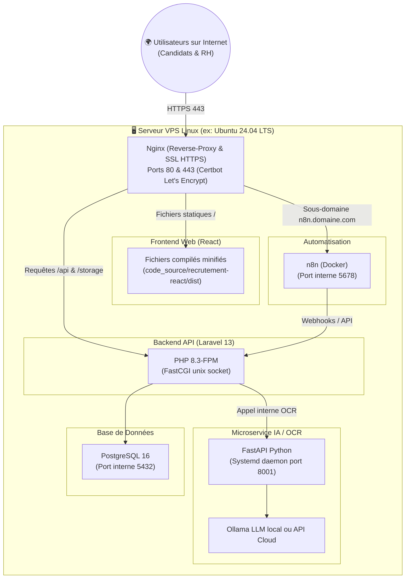

# 🌐 Guide Complet : Mise en Ligne & Déploiement sur un Serveur de Production
## Projet : Plateforme de Recrutement Alpha Ciment

Ce guide détaille pas à pas comment déployer l'intégralité de la solution Alpha Ciment sur un serveur distant (VPS / Cloud) pour rendre l'application accessible sur Internet avec un nom de domaine et le protocole sécurisé **HTTPS**.

---

## 🏛️ 1. Architecture de Production Recommandée

En production, un seul serveur Linux (Ubuntu 22.04 ou 24.04 LTS) orchestré par **Nginx** en Reverse-Proxy gère l'ensemble :



---

## 📋 2. Prérequis d'Hébergement

### A. Choix du Serveur (VPS)
- **Fournisseur** : OVHcloud, Hetzner, DigitalOcean, Linode, AWS Lightsail ou Scaleway.
- **Système d'exploitation** : **Ubuntu 24.04 LTS** (ou 22.04 LTS).
- **Spécifications recommandées** :
  - *Option Standard (avec IA légère ou LLM via API Cloud)* : 2 vCPUs, 4 Go RAM, 40 Go SSD (~5 à 10 € / mois).
  - *Option Full Local (avec LLM Ollama 7B exécuté directement sur le CPU du VPS)* : 4 à 8 vCPUs, 8 à 16 Go RAM.

### B. Nom de Domaine & DNS
Achetez un domaine (ex: `alphaciment-recrutement.com` ou sous-domaine `recrutement.alphaciment.mg`).
Dans la zone DNS de votre registrar, créez 2 enregistrements de type **A** :
- `@` ou `recrutement` -> `IP_DU_SERVEUR` (pour l'application web & l'API)
- `n8n` -> `IP_DU_SERVEUR` (pour l'interface n8n)

---

## 🛠️ 3. Préparation Initiale du Serveur VPS

Connectez-vous à votre serveur en SSH :
```bash
ssh root@IP_DU_SERVEUR
```

### A. Mise à jour du système
```bash
apt update && apt upgrade -y
apt install -y curl wget git unzip zip software-properties-common ufw
```

### B. Sécurisation du Pare-Feu (UFW)
```bash
ufw allow OpenSSH
ufw allow 'Nginx Full'
ufw enable
```

---

## 🐘 4. Installation des Runtimes (PHP 8.3, Node.js, PostgreSQL, Docker)

### A. PHP 8.3 & Extensions (Obligatoire pour Laravel 13)
```bash
add-apt-repository ppa:ondrej/php -y
apt update
apt install -y php8.3-fpm php8.3-cli php8.3-pgsql php8.3-curl php8.3-mbstring \
               php8.3-xml php8.3-zip php8.3-gd php8.3-intl php8.3-bcmath

# Installer Composer
curl -sS https://getcomposer.org/installer | php -- --install-dir=/usr/local/bin --filename=composer
```

### B. PostgreSQL 16
```bash
apt install -y postgresql postgresql-contrib
systemctl enable postgresql
systemctl start postgresql
```

### C. Node.js 20 LTS & npm
```bash
curl -fsSL https://deb.nodesource.com/setup_20.x | bash -
apt install -y nodejs
```

### D. Python 3 & venv
```bash
apt install -y python3 python3-pip python3-venv
```

### E. Docker & Docker Compose (pour n8n)
```bash
curl -fsSL https://get.docker.com | sh
usermod -aG docker $USER
```

---

## 🗄️ 5. Configuration de la Base de Données en Production

1. Connectez-vous sous l'utilisateur `postgres` :
```bash
su - postgres
psql
```

2. Créez la base et un utilisateur avec mot de passe robuste :
```sql
CREATE DATABASE gestion_recrutement;
CREATE USER alpha_prod WITH ENCRYPTED PASSWORD 'VOTRE_MOT_DE_PASSE_TRES_SECURISE';
GRANT ALL PRIVILEGES ON DATABASE gestion_recrutement TO alpha_prod;
\q
exit
```

---

## 📂 6. Déploiement du Code Source sur le Serveur

Créez le répertoire applicatif et clonez le dépôt :
```bash
mkdir -p /var/www/alphaciment
cd /var/www/alphaciment
git clone https://github.com/VOTRE_COMPTE/recrutement_alphaCiment.git .
```

### A. Initialiser les données PostgreSQL
Exécutez le script SQL initial :
```bash
PGPASSWORD='VOTRE_MOT_DE_PASSE_TRES_SECURISE' psql -U alpha_prod -d gestion_recrutement -h 127.0.0.1 -f /var/www/alphaciment/sql/gestion_recrutement.sql
```

---

## ⚙️ 7. Configuration du Backend Laravel 13 en Production

```bash
cd /var/www/alphaciment/code_source/recrutement
```

1. **Installer les dépendances de production sans paquets de dev** :
```bash
composer install --no-dev --optimize-autoloader
```

2. **Créer le `.env` de production** :
```bash
cp .env.example .env
nano .env
```
Modifiez les lignes clés :
```ini
APP_NAME="Recrutement Alpha Ciment"
APP_ENV=production
APP_DEBUG=false
APP_URL=https://recrutement.alphaciment.com
FRONTEND_URL=https://recrutement.alphaciment.com

DB_CONNECTION=pgsql
DB_HOST=127.0.0.1
DB_PORT=5432
DB_DATABASE=gestion_recrutement
DB_USERNAME=alpha_prod
DB_PASSWORD=VOTRE_MOT_DE_PASSE_TRES_SECURISE

SESSION_DRIVER=database
QUEUE_CONNECTION=database
FILESYSTEM_DISK=local

# Configuration Mail de production (ex: Brevo, Gmail SMTP, ou serveur SMTP de l'entreprise)
MAIL_MAILER=smtp
MAIL_HOST=smtp.gmail.com
MAIL_PORT=587
MAIL_USERNAME=recrutement@alphaciment.mg
MAIL_PASSWORD=votre_mot_de_passe_application
MAIL_ENCRYPTION=tls
MAIL_FROM_ADDRESS="recrutement@alphaciment.mg"
MAIL_FROM_NAME="Recrutement Alpha Ciment"
```

3. **Générer la clé & créer le lien de stockage** :
```bash
php artisan key:generate
php artisan storage:link
```

4. **Optimiser les caches pour des performances maximales** :
```bash
php artisan config:cache
php artisan route:cache
php artisan view:cache
```

5. **Définir les permissions de fichiers pour le serveur web** :
```bash
chown -R www-data:www-data /var/www/alphaciment/code_source/recrutement/storage
chown -R www-data:www-data /var/www/alphaciment/code_source/recrutement/bootstrap/cache
chmod -R 775 /var/www/alphaciment/code_source/recrutement/storage
chmod -R 775 /var/www/alphaciment/code_source/recrutement/bootstrap/cache
```

---

## ⚛️ 8. Compilation du Frontend React

Sur le serveur (ou en amont sur votre PC avant d'envoyer le dossier `dist/`) :

```bash
cd /var/www/alphaciment/code_source/recrutement-react
```

1. Créez le `.env` :
```bash
echo "VITE_BACKEND_URL=https://recrutement.alphaciment.com" > .env
```

2. Installez et compilez :
```bash
npm install
npm run build
```
Les fichiers statiques minifiés de production sont générés dans :  
`/var/www/alphaciment/code_source/recrutement-react/dist/`.

---

## 🐍 9. Déploiement du Microservice IA (FastAPI) en Démon Systemd

```bash
cd /var/www/alphaciment/code_source/ocr
python3 -m venv venv
./venv/bin/pip install --upgrade pip
./venv/bin/pip install -r requirements.txt
```

Créez un service Linux persistant qui redémarre automatiquement :
```bash
nano /etc/systemd/system/alphaciment-ocr.service
```
Collez la configuration :
```ini
[Unit]
Description=Microservice FastAPI Alpha Ciment OCR & NER
After=network.target

[Service]
User=www-data
Group=www-data
WorkingDirectory=/var/www/alphaciment/code_source/ocr
ExecStart=/var/www/alphaciment/code_source/ocr/venv/bin/python -m uvicorn main:app --host 127.0.0.1 --port 8001
Restart=always
RestartSec=5

[Install]
WantedBy=multi-user.target
```

Activez et démarrez le service :
```bash
systemctl daemon-reload
systemctl enable alphaciment-ocr
systemctl start alphaciment-ocr
systemctl status alphaciment-ocr
```

---

## ⚡ 10. Déploiement de n8n sous Docker

Placez-vous dans le dossier `automatisation` :
```bash
cd /var/www/alphaciment/automatisation
```
Créez ou adaptez le fichier `.env` pour n8n :
```ini
N8N_PORT=5678
N8N_PROTOCOL=https
N8N_HOST=n8n.alphaciment.com
N8N_WEBHOOK_URL=https://n8n.alphaciment.com/
GENERIC_TIMEZONE=Indian/Antananarivo
```
Démarrez n8n en arrière-plan :
```bash
docker compose up -d
```

---

## 🌐 11. Configuration Nginx & Certificats SSL HTTPS (Let's Encrypt)

Créez le fichier de configuration Nginx du site :
```bash
nano /etc/nginx/sites-available/alphaciment.conf
```

Collez la configuration complète :
```nginx
# 1. APPLICATION PRINCIPALE : FRONTEND REACT + BACKEND LARAVEL
server {
    listen 80;
    server_name recrutement.alphaciment.com;

    # Racine du Frontend React compilé
    root /var/www/alphaciment/code_source/recrutement-react/dist;
    index index.html;

    client_max_body_size 50M;

    # Fichiers médias et CV téléversés (Laravel Storage)
    location /storage/ {
        alias /var/www/alphaciment/code_source/recrutement/storage/app/public/;
        try_files $uri =404;
        expires 30d;
        add_header Cache-Control "public, no-transform";
    }

    # API Backend Laravel 13
    location /api/ {
        alias /var/www/alphaciment/code_source/recrutement/public/;
        try_files $uri $uri/ /index.php?$query_string;

        location ~ \.php$ {
            include snippets/fastcgi-php.conf;
            fastcgi_pass unix:/var/run/php/php8.3-fpm.sock;
            fastcgi_param SCRIPT_FILENAME /var/www/alphaciment/code_source/recrutement/public/index.php;
            include fastcgi_params;
        }
    }

    # Routes du Frontend React (SPA Fallback)
    location / {
        try_files $uri $uri/ /index.html;
    }
}

# 2. SOUS-DOMAINE N8N
server {
    listen 80;
    server_name n8n.alphaciment.com;

    location / {
        proxy_pass http://127.0.0.1:5678;
        proxy_http_version 1.1;
        proxy_set_header Upgrade $http_upgrade;
        proxy_set_header Connection 'upgrade';
        proxy_set_header Host $host;
        proxy_set_header X-Real-IP $remote_addr;
        proxy_set_header X-Forwarded-For $proxy_add_x_forwarded_for;
        proxy_set_header X-Forwarded-Proto $scheme;
        proxy_cache_bypass $http_upgrade;
    }
}
```

Activez le site et rechargez Nginx :
```bash
ln -s /etc/nginx/sites-available/alphaciment.conf /etc/nginx/sites-enabled/
nginx -t
systemctl reload nginx
```

### B. Générer les certificats SSL HTTPS gratuits (Certbot)
```bash
apt install -y certbot python3-certbot-nginx
certbot --nginx -d recrutement.alphaciment.com -d n8n.alphaciment.com
```
Certbot configure automatiquement les redirections HTTP vers HTTPS et le renouvellement automatique des certificats !

---

## ✅ 12. Checklist Finale de Validation en Ligne

| Service | URL en Ligne | Test de Vérification |
| :--- | :--- | :--- |
| **Portail Candidats** | `https://recrutement.alphaciment.com/` | Affichage des offres, formulaires de postulation fonctionnels |
| **Back-Office RH** | `https://recrutement.alphaciment.com/login` | Connexion avec `admin@alphaciment.local` / `password` |
| **API Laravel** | `https://recrutement.alphaciment.com/api/public/offres` | Retourne la liste JSON des offres d'emploi |
| **Documents / CVs** | `https://recrutement.alphaciment.com/storage/...` | Téléchargement sécurisé des PDFs |
| **Microservice IA** | `http://127.0.0.1:8001/health` (local) | Statut PaddleOCR et parseur LLM OK |
| **Workflows n8n** | `https://n8n.alphaciment.com/` | Accès à l'interface n8n sous HTTPS |
